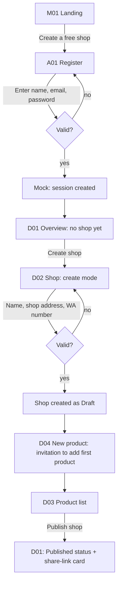
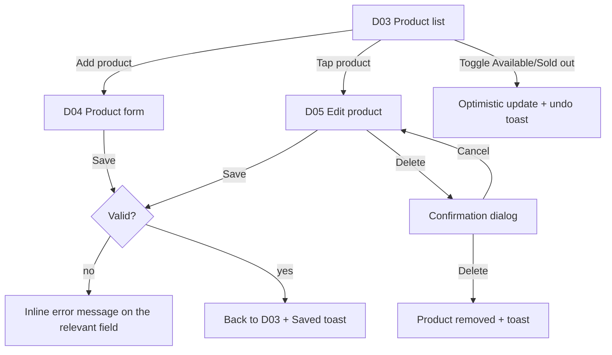
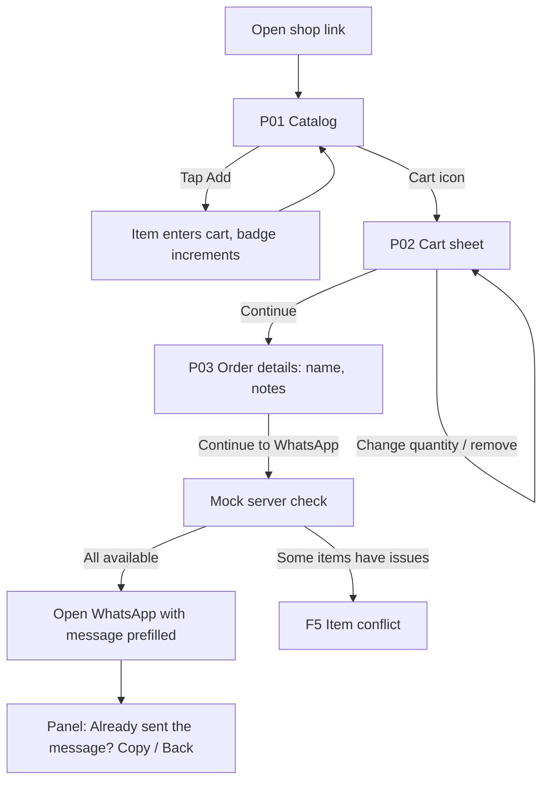
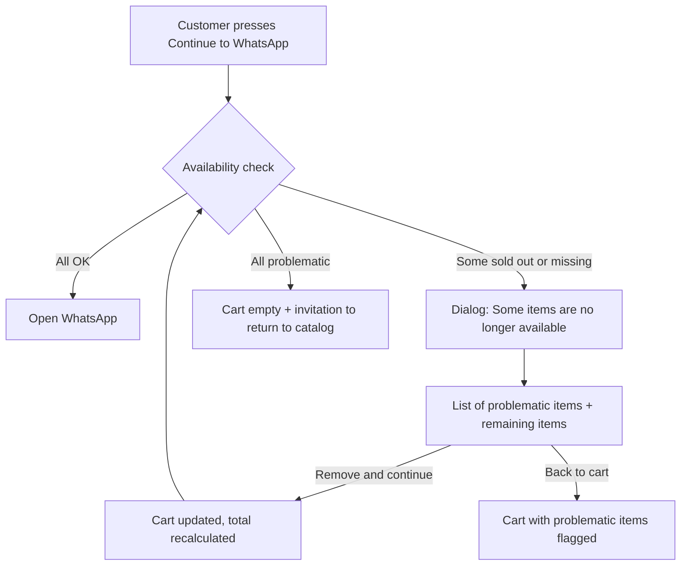

# 04 — User Flows

Screen codes refer to `05-screen-specs.md`. In Phase 1, all "system"
steps are simulated by mocks (see `07`).

## F1. Owner onboarding

**Rules:**
- After signup, a user without a shop is directed to D01, which shows
  the **initial checklist** (1. Create shop, 2. Add products, 3.
  Publish), with the next step highlighted.
- The **Publish** button is active only when: the shop has a valid
  WhatsApp number **and** at least 1 available product. Otherwise the
  button is disabled with a clear reason ("Add at least 1 product to
  publish").
- After publishing: show a "Your shop is live" card with the link,
  **Copy**, **Share to WhatsApp**, and **View shop** buttons.

## F2. Manage products

**Rules:**
- The **Available/Sold out** toggle is one-tap directly from the list,
  without opening the form, with a "Marked Sold out · Undo" toast.
- Delete always goes through a confirmation dialog naming the product.
  An alternative suggestion is shown in the dialog: "Just mark it Sold
  out instead?".
- The form must not lose filled-in data on validation failure. A
  "changes not saved" warning when the user leaves a modified form.

## F3. Manage categories

From D06: add (single-line input + button), rename (inline), reorder
(up/down buttons; drag optional), delete (confirmation; the products
inside become "Uncategorized", and the dialog states the count).
Duplicate names (case-insensitive) are rejected with an inline message.

## F4. Customer orders (main path)

**Rules:**
- The cart is stored per shop in `localStorage` and persists across
  refreshes.
- **Sold out** products appear in the catalog with a "Sold out" label
  and a disabled add button.
- The "Continue to WhatsApp" button shows the honesty helper text (see
  `01` section 6).
- Customer name is required; notes are optional (max 200 characters).

## F5. Item out of stock / changed at checkout

**Rules:** no item is silently dropped; the user is always told which
items and chooses the next step. The total is always recalculated after
any change.

## F6. Shop not found or draft

Missing slug **or** shop not yet published → P04 screen (title "Shop
not found", button to the WarungKu landing). No hint that the slug
might be a draft.

## F7. Log in, log out, access

- Login: email + password → D01. Wrong credentials → generic message
  "Email or password is incorrect".
- Log out: from the account menu → back to landing.
- Accessing `/dashboard` without a session → `/login` (no scary
  message, just "Log in to manage your shop").
- Forgot password: link on A02; Phase 1 is UI-only (optional).

## F8. Demo tools (development only)

`DevToolbar` floats in a corner, visible only when
`NODE_ENV === 'development'` or a demo flag, containing:
- **Scenarios:** (a) not logged in, (b) logged in without shop, (c)
  logged in as Bu Ratna's shop.
- **Simulate a product going Sold out** (to test F5).
- **Reset mock data**.

This tool must not appear in a production build used by the judges,
unless deliberately enabled for a demo.

## Edge cases the UI must handle

| Case | Behavior |
|---|---|
| Published shop with no products | Catalog shows a friendly empty state: "This shop has no products yet" |
| All products sold out | Catalog shows, all buttons disabled, info banner |
| Long product name/description | Truncated (`line-clamp`), layout not broken |
| Price Rp 0 | Shows "Rp 0"; no special behavior (do not show "Free" unless requested) |
| Cart contains a product the owner just deleted | Treated as F5 |
| `localStorage` unavailable (private mode) | Cart runs in memory; no crash; no scary message |
| Invalid WA number at checkout | Cannot happen (validated when the shop is saved); fallback = disabled button + "The seller has not set up a WhatsApp number" |
| Slow network | Skeletons, buttons show loading state, no double-clicks (prevents double submission) |
| Image fails to load | Fallback to product initials |
